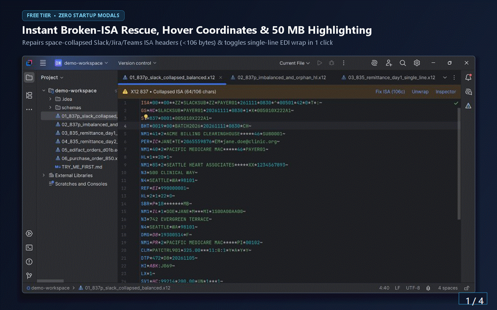

# EdiPrism X12 EDIFACT — Offline EDI Inspector, Semantic Diff & HIPAA Scrubber

**Deterministic, 100% offline / air-gapped `ASC X12` & `UN/EDIFACT` inspector, semantic diff, financial balancing validator, and HIPAA test-fixture scrubber for all JetBrains IDEs** (`IntelliJ IDEA`, `Rider`, `PyCharm`, `DataGrip`, `GoLand`, `WebStorm`).

Built for healthcare (`837P`/`837I`/`837D`, `835`, `270`/`271`, `276`/`277`, `834`), retail & supply-chain (`850`, `856`, `810`, `997`/`999`), logistics, and banking engineers who cannot paste regulated HIPAA, PCI, or NDA payloads into web-based EDI parsers or cloud AI tools.

- **100% Local & Air-Gapped:** Zero backend servers, zero databases, zero telemetry, zero cloud or LLM API calls.
- **Cross-IDE Native:** Works identically across `IntelliJ IDEA`, `Rider`, `PyCharm`, `DataGrip`, `GoLand`, and `WebStorm` (`2025.1`+).

---

## Installation

- **Direct Marketplace Page:** **[Install EdiPrism X12 EDIFACT on JetBrains Marketplace](https://plugins.jetbrains.com/plugin/35990-ediprism-x12-edifact)**
- **Inside Any JetBrains IDE (`2025.1+`):** Go to **Settings / Preferences** (`Ctrl+Alt+S` / `Cmd+,`) -> **Plugins** -> **Marketplace** -> search **`EdiPrism X12 EDIFACT`** -> click **Install** (no IDE restart required).
  *(JetBrains IDEs also suggest **EdiPrism X12 EDIFACT** automatically whenever you open `.x12`, `.edifact`, `.edi`, `.837`, `.835`, `.850`, or `.999` files!)*

---

## Free vs. `[Pro]` Capabilities

| Capability | Free Tier | `[Pro]` Tier (14-Day Free Trial) |
| :--- | :---: | :---: |
| **Lenient `ISA` (`<106`-byte Slack/Jira/Teams) & `UNA` Pre-Normalizer + 1-Click Padding Fix** | Yes | Yes |
| **Fast Incremental Large-File (`20–50+ MB`) Syntax Highlighting** | Yes | Yes |
| **Hover & Quick-Doc (`Ctrl+Q`) Coordinate Tooltips (`NM1-08`, `CLM-02`, `SV1-01-2`, `NAD-02`) & Loop Folding** | Yes | Yes |
| **1-Click Wrap / Unwrap Single-Line EDI (`Alt+Shift+E`, `?'` release-character safe)** | Yes | Yes |
| **`999` / `997` Rejection-to-Source Pinpointer (`IK3`/`IK4` `ST`-Relative Jump to Exact Source Element)** | — | **Yes** |
| **1-Click Unit-Test Fixture Slicer & HIPAA Scrubber (`Alt+Shift+X` — Re-Numbered `HL` & Balanced Trailers)** | — | **Yes** |
| **Hierarchical `HL` & Business Loop Tree + Live Breadcrumbs + Inline Ghost-Text Hints (`Alt+Shift+I`)** | — | **Yes** |
| **1-Click (`Alt+Shift+D`) & Native `Ctrl+D` Semantic EDI Diff (Masks `ISA`/`GS`/`ST`/`UNB` Noise)** | — | **Yes** |
| **Offline Trailer (`SE01`/`GE01`/`IEA01`), Orphan `HL` & `BigDecimal` Claim/Remittance Balancing** | — | **Yes** |
| **Deterministic Offline HIPAA / PII Scrubber (Preserves Widths & Luhn / `80840` NPI Check Digits)** | — | **Yes** |
| **Git-Shared `.ediprism` Partner Schemas (`StAEDI` XML & JSON `BYOS`) + Offline JSON / CSV Export** | — | **Yes** |

---

## Quick Keyboard Shortcuts & Workflow

- **`Alt + Shift + E`:** Toggle **Wrap / Unwrap Single-Line EDI** (safely ignores escaped `UN/EDIFACT` `?'` delimiters).
- **`Alt + Shift + D`** *(or select 2 files in Project View and press **`Ctrl + D`**)*: Launch **EdiPrism Semantic EDI Diff `[Pro]`**, masking envelope dates, times, and control numbers (`<DATE>`, `<TIME>`, `<GCN>`, `<TCN>`) so real business loop changes stand out immediately.
- **Hover or `Ctrl + Q`:** Inspect exact segment, element, composite sub-element, and repetition coordinates (`SV1-01-2`, `CLM-02`, `ISA-06`).
- **Right-Hand `EdiPrism` ToolWindow:** Browse **Loops**, run **Validate** (plus load custom `StAEDI` `.xml` or `.json` `BYOS` schemas), and run **Scrub & Export** (deterministic `HmacSHA256` HIPAA/PII anonymizer + JSON/CSV export).

---

## Engineering & Troubleshooting Guides

- **[How to Fix "ISA Segment Must Be 106 Characters" After Slack, Jira, or Teams Copy-Paste](./guides/fix-collapsed-x12-isa-106-characters.md)**
- **[How to Map ASC X12 `999` (`IK3` / `IK4`) Rejections Directly to Your `837` / `834` / `850` File](./guides/map-x12-999-ik3-ik4-rejection-to-837-segment.md)**
- **[How to Create HIPAA-Safe `837` & `835` Unit-Test Fixtures Offline (Preserving `80840` NPIs & Balancing)](./guides/hipaa-scrub-837-835-unit-test-fixtures-offline.md)**

---

## Sister Plugin in the EdiPrism Air-Gapped Suite

- **[EbcdicPrism Copybook Viewer](https://ediprism.github.io/cobol/):** 100% offline mainframe `COBOL Copybook` (`.cpy`) byte-offset calculator, `EBCDIC` / `COMP-3` / `Zoned Decimal` record overlay decoder, `S0C7` validator, semantic binary diff, and `PCI-DSS` binary PAN scrubber ([GitHub Docs & Issues](https://github.com/EdiPrism/ebcdicprism)).

---

## Legal, Privacy & Support

- **Privacy & Air-Gapped Security Attestation:** [PRIVACY.md](./PRIVACY.md) • [ediprism.github.io/privacy.html](https://ediprism.github.io/privacy.html)
- **End-User License Agreement (EULA):** [EULA.md](./EULA.md) • [ediprism.github.io/eula.html](https://ediprism.github.io/eula.html)
- **Release Notes:** [CHANGELOG.md](./CHANGELOG.md)
- **Bug Reports & Feature Requests:** [GitHub Issues](https://github.com/EdiPrism/ediprism/issues) • [Support Hub](https://ediprism.github.io/support.html)

*X12 is a registered trademark of X12 Incorporated. EdiPrism is an independent clean-room developer tool derived from public-domain US Federal specifications (`17 U.S.C. § 105`) and public UNECE directories, and is not affiliated with, endorsed by, or sponsored by X12 Incorporated or UNECE.*
